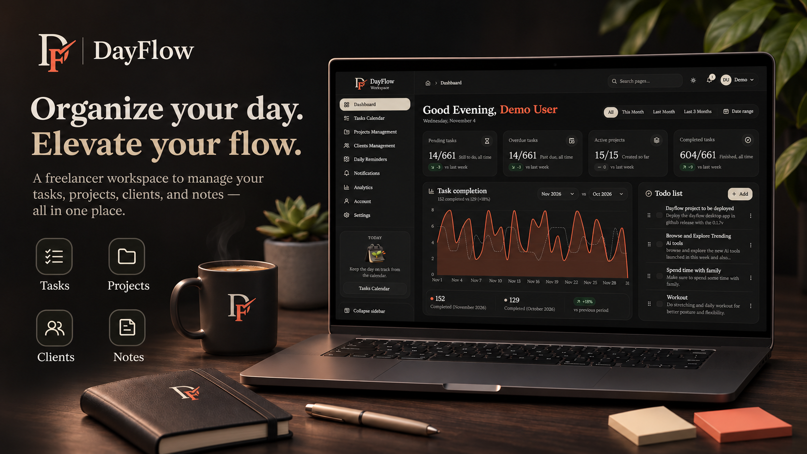

# DayFlow

**Organize your day. Elevate your flow.**

A workspace built for freelancers to manage clients, projects, tasks, meetings, notes, reminders, and more, all in one place. One Supabase project (Auth, Postgres, RLS) serves every surface; there is no sync service between them.

| Package | Role | Dev URL |
| --- | --- | --- |
| `apps/web` | Vite + React app: workspace, client portal, public site | `http://localhost:5173` |
| `apps/web/src-tauri` | Tauri 2 desktop shell around the web build (macOS, Windows) | n/a |
| `apps/mobile` | Flutter app, UI-only preview with sample data | n/a |
| `supabase/functions/assistant` | Edge Function for the Flowy assistant (Gemini) | n/a |

## Stack

**Web:** Vite 8, React 19, TypeScript 6, React Router 7, Tailwind CSS 4, shadcn/ui (Radix), framer-motion, recharts, `@dnd-kit`, date-fns, sonner, next-themes, Embla carousel. Package manager: Bun.
**Desktop:** Tauri 2 (Rust), `dayflow://` deep link for Google sign-in.
**Mobile:** Flutter (Dart SDK ^3.13.7), no packages yet.
**Backend:** Supabase Auth, Postgres with RLS, one Edge Function. Apps never change the database.

Brand copy (name, tagline, descriptions, portals) lives in [`brandManifest.json`](./brandManifest.json). Web imports it directly; mobile reads a generated Dart file. Theme tokens live in [`shared/brand/theme.json`](./shared/brand/theme.json).

## Layout

```
brandManifest.json      Brand copy, single source
apps/
  web/                  Vite app (src/app, features/{workspace,client,site}, services, shared)
    src-tauri/          Desktop shell
    scripts/            Theme / brand generators, logo scripts, demo seeds
  mobile/               Flutter app (lib/{app,core,features,shared})
shared/brand/           theme.json (tokens) and generated theme.css / theme.ts
supabase/functions/     assistant Edge Function
scripts/                migrations/ (append-only SQL) and seeds/
docs/                   PRD, RULES, MEMORY, DATABASE + web/ and mobile/ docs
```

Web alias: `@/*` maps to `apps/web/src`.

## Setup

Requires Bun. Mobile needs Flutter and Xcode or Android Studio. Web needs `apps/web/.env` with `VITE_SUPABASE_URL` and `VITE_SUPABASE_PUBLISHABLE_KEY` (see [web architecture](./docs/web/ARCHITECTURE.md#config)).

```sh
cd apps/web
bun install
bun run dev
```

Mobile: `cd apps/mobile && flutter pub get && flutter run`.

## Scripts

From `apps/web`:

| Script | Does |
| --- | --- |
| `bun run dev` | Vite dev server on port 5173 |
| `bun run build` | Checks generated theme and brand files, `tsc -b`, `vite build` |
| `bun run lint` | ESLint |
| `bun run theme:generate` | Rebuild `shared/brand/theme.css` / `theme.ts` from `theme.json` |
| `bun run brand:generate` | Rebuild `apps/mobile/lib/core/constants/brand_manifest.dart` from `brandManifest.json` |
| `bun run tauri:dev` / `tauri:build` | Desktop app |
| `bun run seed:present-month-tasks` | Demo-account tasks for the current month (demo account only) |

From `apps/mobile`: `flutter analyze`, `flutter test`, `dart format .`.

## Docs

Start with [CLAUDE.md](./CLAUDE.md). Shared: [PRD](./docs/PRD.md), [RULES](./docs/RULES.md), [MEMORY](./docs/MEMORY.md), [DATABASE](./docs/DATABASE.md). Per package: [docs/web/](./docs/web/) and [docs/mobile/](./docs/mobile/) (ARCHITECTURE, DESIGN, RULES, TASKS, MEMORY).

## Deploy

| Surface | Where |
| --- | --- |
| Web | Vercel, root directory `apps/web`, redeploys on push: https://dayflow-web-version.vercel.app |
| Desktop | [GitHub Releases](https://github.com/farhan-6710/dayflow/releases) (`.dmg`, `.exe`), built by hand with `tauri:build` |
| Mobile | Not released |
| Database, Edge Function | Supabase; the owner applies SQL and deploys the function by hand |

---

## Try DayFlow (web)

1. Open **[https://dayflow-web-version.vercel.app/](https://dayflow-web-version.vercel.app/)**
2. Sign in at **[Workspace login](https://dayflow-web-version.vercel.app/workspace/auth)** with the demo account on the login screen (or create your own)
3. Optional: clients use **[Client portal login](https://dayflow-web-version.vercel.app/client-portal/auth)** with an email linked to a client record

The same account works on desktop; the mobile preview does not sign in yet.

---

## Install desktop

1. Open **[GitHub Releases](https://github.com/farhan-6710/dayflow/releases)** and go to the latest release.
2. Under **Assets**, download the file for your computer:
   - **macOS:** the link ending in `.dmg`
   - **Windows:** the link ending in `.exe`
3. **macOS:** open the `.dmg`, drag **DayFlow** into **Applications**, then eject the disk image (`hdiutil eject /Volumes/DayFlow`).
4. **Windows:** run the `.exe` installer.

### If your system blocks the app

**macOS** — if you see *“DayFlow” is damaged and can’t be opened. You should move it to the Bin*:

```bash
xattr -cr /Applications/DayFlow.app
```

Then open DayFlow again from Applications (or right-click → Open).

**Windows** — if Windows blocks the installation:

```text
More info → Run anyway
```

Google sign-in on desktop opens the system browser and returns via `dayflow://`.

---

## Uninstall DayFlow

**macOS:**

```bash
rm -rf /Applications/DayFlow.app
```

**Windows:**

```text
Settings → Apps → Installed apps → DayFlow → Uninstall
```
