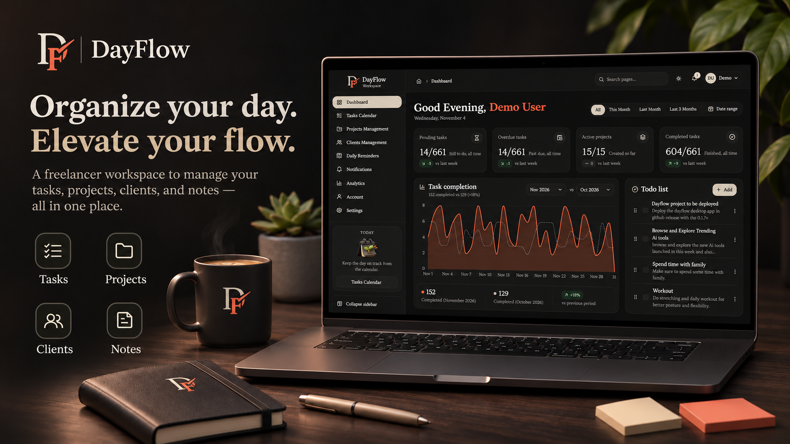

# DayFlow

**Organize your day. Elevate your flow.**

A workspace built for freelancers to manage clients, projects, tasks, meetings, notes, reminders, and more — all in one place.

**Platforms:** Web · Desktop (macOS & Windows) · Mobile (Flutter app in development, UI preview only)

---

## Try DayFlow (web)

1. Open **[https://bisque-gull-237581.hostingersite.com](https://bisque-gull-237581.hostingersite.com)**
2. Sign in at **[Workspace login](https://bisque-gull-237581.hostingersite.com/workspace/auth)** with the demo account on the login screen (or create your own)
3. Optional: clients use **[Client portal login](https://bisque-gull-237581.hostingersite.com/client-portal/auth)** with an email linked to a client record

Same credentials work on desktop and Android — one Supabase project for all surfaces.

---

## Install desktop

Download from [GitHub Releases](https://github.com/farhan-6710/dayflow/releases).

**macOS:** open the `.dmg`, drag to Applications. If Gatekeeper blocks: `xattr -cr /Applications/DayFlow.app` or right-click → Open.

**Windows:** run the installer. If SmartScreen appears: More info → Run anyway.

Google sign-in on desktop opens the system browser and returns via `dayflow://`.

---


## Stack

| Layer | Stack |
|-------|--------|
| Web UI | React 19 · TypeScript · Vite · Tailwind v4 · shadcn/ui |
| Desktop shell | Tauri 2 (macOS & Windows) |
| Mobile | Flutter (in development) |
| Backend | Supabase (Auth, Postgres, RLS) — shared |
| Tooling | Bun (web) |

```text
shared/brand/                      Brand manifest (shared by web + mobile)
apps/web/src/features/workspace/   Owner app (/workspace)
apps/web/src/features/client/      Client portal (/client-portal)
apps/web/src/services/             Web Supabase access
apps/web/src/shared/               Shared UI, auth, settings and brand re-exports
apps/mobile/                       Flutter app, to be built (docs and images for now)
scripts/migrations/                Shared Postgres SQL
shared/brand/                      Brand manifest and theme tokens (theme.json), used by web and mobile
docs/                              Shared: PRD, database, rules, memory
apps/web/docs/                     Web: spec, architecture, design, rules, tasks, memory
apps/mobile/docs/                  Mobile: Flutter architecture, rules, tasks, memory
```

---

## Documentation

| Doc | Purpose |
|-----|---------|
| [docs/PRD.md](./docs/PRD.md) | Product goals, users, requirements (both apps) |
| [docs/DATABASE.md](./docs/DATABASE.md) | Data model, client portal RPCs, DB contract (both apps) |
| [docs/RULES.md](./docs/RULES.md) | Rules for every app |
| [docs/MEMORY.md](./docs/MEMORY.md) | Durable project-wide decisions |
| [shared/brand/theme.json](./shared/brand/theme.json) | Theme tokens for web and mobile (generated into each app's format) |
| [apps/web/docs/ARCHITECTURE.md](./apps/web/docs/ARCHITECTURE.md) | Web structure and data flow |
| [apps/web/docs/DESIGN.md](./apps/web/docs/DESIGN.md) | Web UI/UX direction |
| [apps/web/docs/RULES.md](./apps/web/docs/RULES.md) | Web conventions |
| [apps/web/docs/TASKS.md](./apps/web/docs/TASKS.md) | Web roadmap and status |
| [apps/web/docs/MEMORY.md](./apps/web/docs/MEMORY.md) | Web decisions |

Brand copy (shared by web + mobile): [`shared/brand/brandManifest.json`](./shared/brand/brandManifest.json)

Mobile (Flutter) plan and rules: [apps/mobile/docs/ARCHITECTURE.md](./apps/mobile/docs/ARCHITECTURE.md)
